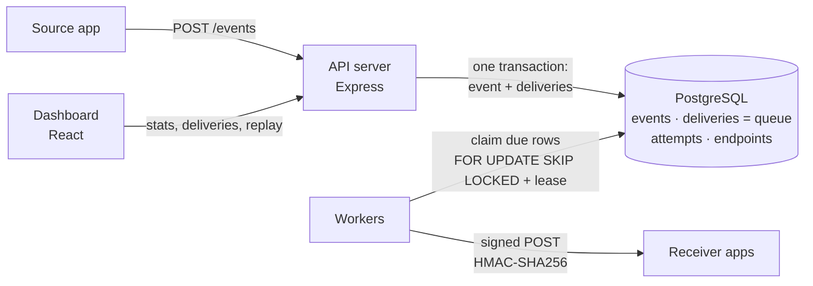
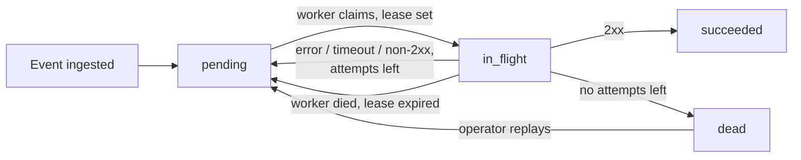

# Webhook Delivery Platform

A backend that takes events from one application and delivers them to other
applications as HTTP webhooks: **reliably, even when the receiver is slow,
down or flaky.** Every attempt is logged, failures are retried with
exponential backoff and jitter, deliveries that run out of retries go to a
dead-letter state, and an operator can replay them from a dashboard.

Built from scratch in TypeScript, Node.js and PostgreSQL. Svix and Hookdeck
Outpost were used only as architecture references.

## Architecture

PostgreSQL is both the store and the queue between the API and the workers,
so there is no Redis or message broker to run.



Life of one delivery:



## How the design handles the hard cases

The design assumes retries will happen and makes them safe, instead of
claiming exactly-once delivery.

| Problem | What the platform does | Where |
|---|---|---|
| Event accepted, then lost before delivery | The event and its fan-out delivery rows are committed in **one transaction** before the API answers `202`. | `src/events.ts` |
| Sender submits the same event twice | Unique **idempotency key** (`Idempotency-Key` header). A repeat returns the original event and creates nothing (`200`, `duplicate: true`), including simultaneous repeats. | `src/events.ts` |
| Several workers want the same work | `FOR UPDATE SKIP LOCKED`: each due delivery is claimed by exactly one worker and no worker waits on another's locks. | `src/worker.ts` `claimDue` |
| Worker crashes mid-delivery | Each claim sets a **lease** (`locked_until`). When it expires, another worker picks the delivery up. Attempts are counted at claim time, so a delivery that keeps crashing workers still runs out of attempts. | `src/worker.ts` |
| A stalled worker comes back after its lease expired | Settling is **fenced on the attempt count**, so the stale result cannot overwrite the newer claim. | `src/worker.ts` `settle` |
| Receiver can't tell whether it already processed an event | **At-least-once** delivery with a stable `webhook-id` (the event id) on every retry, so receivers can dedupe. | `src/worker.ts` `sendRequest` |
| Retry storms against a recovering receiver | **Exponential backoff with full jitter**, capped at a maximum delay. | `src/backoff.ts` |
| Forged or replayed requests | **HMAC-SHA256 over `timestamp.body`**. Receivers check the signature in constant time and reject stale timestamps (5 min tolerance). | `src/signing.ts` |
| Receiver keeps failing | After `MAX_ATTEMPTS` the delivery becomes **dead**. It is kept with its full attempt log until an operator **replays** it. | `src/events.ts` `replayDelivery` |

### What a receiver gets

```http
POST /your/webhook HTTP/1.1
content-type: application/json
webhook-id: 3e55046f-…            # stable across retries: dedupe on this
webhook-timestamp: 1793738785     # unix seconds, part of the signature
webhook-signature: v1=5f1c…       # hex HMAC-SHA256(secret, "<timestamp>.<body>")

{"id":"3e55046f-…","type":"bus.arrived","createdAt":"…","data":{ … }}
```

Verifying it takes a few lines (see `verify` in `src/signing.ts`):
recompute the HMAC over `` `${timestamp}.${rawBody}` ``, compare with
`timingSafeEqual`, and reject timestamps older than 5 minutes.

## Running it

Requirements: **Node.js 22.12+** and **PostgreSQL** on `localhost:5433`.
You can get Postgres one of two ways:

- **Docker:** `docker compose up -d db`
- **No Docker (Windows):** a project-local conda env. See the header of
  `scripts/dev-env.ps1` for the one-time setup, then run
  `. .\scripts\dev-env.ps1` in each new terminal.

```bash
npm install
npm install --prefix dashboard
npm test              # failure-path test suite (needs Postgres)
```

### The school-bus demo

```bash
npm run demo          # terminal 1: API + worker + receivers + simulated bus
npm run dashboard     # terminal 2: open http://localhost:5173
```

A simulated school bus (Route 12) publishes a `bus.arrived` event at each stop,
every 4 seconds. The platform fans it out to three receivers:

| Receiver | Behaviour | What it shows |
|---|---|---|
| Parent notifications | Healthy, 80–200 ms | the happy path |
| School office log | Fails ~10% of requests | retries with backoff recover on their own |
| District SMS gateway | Up 45 s, then **down 40 s** (503s and hung requests) | timeouts, dead-letter state, manual replay |

Every fifth stop the bus "resends" the same event to show idempotency: the
repeat creates no new deliveries. Each receiver verifies the HMAC signature
the way a real one would.

During an outage, watch SMS gateway deliveries turn **Retrying**, then
**Dead-lettered** in the dashboard. When the gateway logs `UP` again, open the
**Dead-lettered** tab and press **Replay**; the delivery goes back to the
queue and succeeds. The demo uses a short retry policy (4 attempts, 1–8 s
backoff, 3 s timeout) so the whole cycle takes seconds, and its own database
(`webhook_demo`), which is wiped on every start. All data is simulated.

### Full stack in Docker

```bash
docker compose up --build    # Postgres + API/worker on :3000
npm run dashboard            # dashboard against it
```

## API

| Method | Path | Purpose |
|---|---|---|
| `POST` | `/endpoints` | Register a receiver `{ url, name?, eventTypes?, secret? }`; returns its signing secret |
| `GET` | `/endpoints` | List receivers |
| `POST` | `/events` | Ingest `{ type, payload }` with optional `Idempotency-Key` header; `202` new, `200` duplicate |
| `GET` | `/events/:id` | An event and its deliveries |
| `GET` | `/deliveries?status=` | Recent deliveries (`pending`, `in_flight`, `succeeded`, `dead`) |
| `GET` | `/deliveries/:id/attempts` | Attempt log: status code, error, duration |
| `POST` | `/deliveries/:id/replay` | Re-queue a dead delivery (`409` if it isn't dead) |
| `GET` | `/stats` | Dashboard data: status counts, latency, per-minute timeline, per-endpoint health |
| `GET` | `/health` | Liveness, including a database round-trip |

Configuration (environment variables, defaults in `src/config.ts`):
`DATABASE_URL`, `PORT`, `MAX_ATTEMPTS` (5), `BASE_DELAY_MS` (5 s),
`MAX_DELAY_MS` (15 min), `REQUEST_TIMEOUT_MS` (10 s), `LEASE_MS` (30 s),
`POLL_INTERVAL_MS`, `BATCH_SIZE`.

## Tests

`npm test` runs 15 tests with Vitest against a real PostgreSQL database
(`webhook_test`). Most of them cover failure paths:

- receiver returns errors, then recovers → retried until it succeeds
- receiver never recovers → dead-lettered after max attempts, then replayed
- receiver hangs → request timeout recorded as a failed attempt
- receiver is down (connection refused) → failed attempt, retried
- worker dies mid-delivery → lease expires and another worker delivers it
- stalled worker reports late → its stale result cannot overwrite the new claim
- four workers claim at once → no delivery is claimed twice
- duplicate and simultaneous duplicate idempotency keys → one event, one set of deliveries
- signatures verify, and a tampered body fails verification
- backoff grows exponentially, stays under the cap and applies jitter
- malformed / oversized request bodies → `400` / `413`, not `500`
- dashboard stats: status counts, per-endpoint health, gap-free timeline

## Project layout

```
src/            API, worker, signing, backoff, schema
test/           Vitest suites (real Postgres)
scripts/        demo.ts (school-bus demo), dev-env.ps1, flaky-receiver.ts
dashboard/      React + Vite dashboard
docker-compose.yml, Dockerfile
```

## Limits and next steps

These are deliberately out of scope, and worth knowing about:

- **One process runs the API and the worker.** Workers only talk to Postgres,
  so running more worker processes is safe (that's what `SKIP LOCKED` and the
  leases are for). It just isn't packaged as a separate command yet.
- **No authentication** on the API or the dashboard. It's meant for a trusted
  network.
- **Endpoint secrets are stored in plain text** and there is no secret rotation.
- **No per-endpoint rate limiting or circuit breaker.** Backoff with jitter
  softens retry storms but doesn't cap concurrency per receiver.
- **The attempts table grows forever.** There is no retention job.
