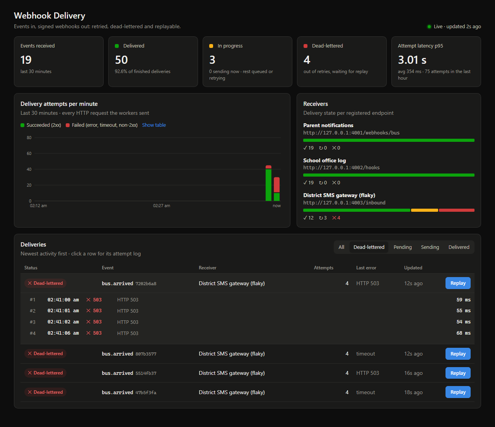
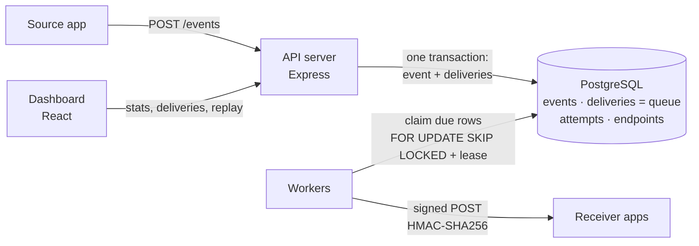
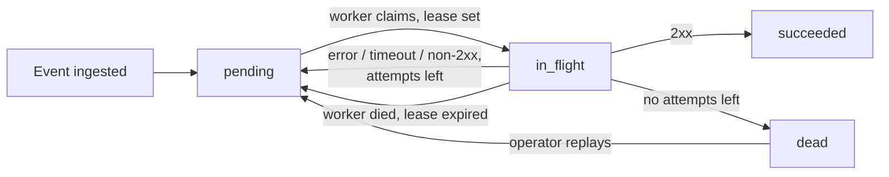
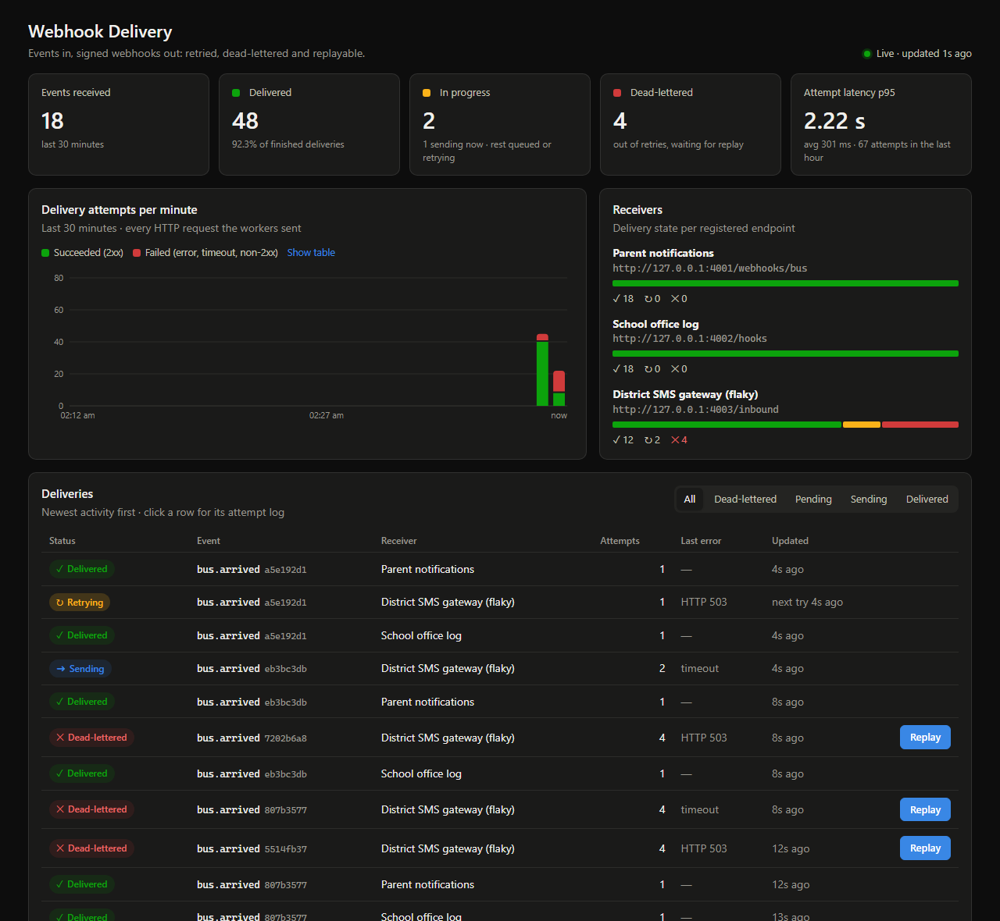
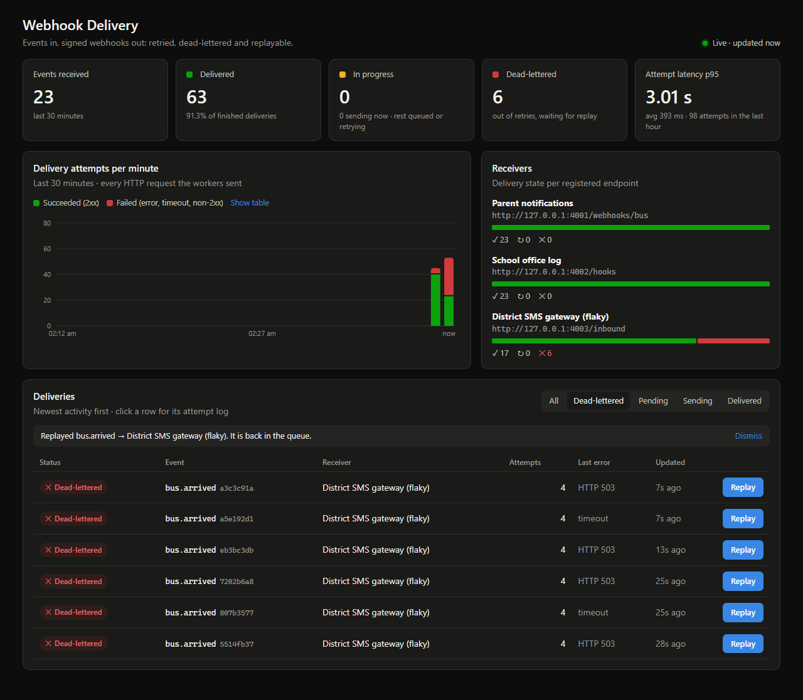
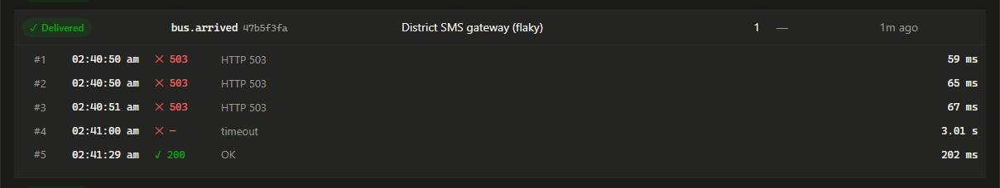

# Webhook Delivery Platform

[](https://github.com/shourya-mittal/Webhook-Delivery-Platform/actions/workflows/ci.yml)

A backend that takes events from one application and delivers them to other
applications as HTTP webhooks: **reliably, even when the receiver is slow,
down or flaky.** Every attempt is logged, failures are retried with
exponential backoff and jitter, deliveries that run out of retries go to a
dead-letter state, and an operator can replay them from a dashboard.

Built from scratch in TypeScript, Node.js and PostgreSQL. Svix and Hookdeck
Outpost were used only as architecture references.



*The dashboard during the school-bus demo, while the SMS gateway is down. Four
deliveries ran out of retries and were dead-lettered. The open row shows each
attempt the platform made. [Full demo walkthrough below.](#the-school-bus-demo)*

## Architecture

PostgreSQL is both the store and the queue between the API and the workers,
so there is no Redis or message broker to run.



Life of one delivery:



## How the design handles the hard cases

The design assumes retries will happen and makes them safe, instead of
claiming exactly-once delivery.

| Problem | What the platform does | Where |
|---|---|---|
| Event accepted, then lost before delivery | The event and its fan-out delivery rows are committed in **one transaction** before the API answers `202`. | `src/events.ts` |
| Sender submits the same event twice | Unique **idempotency key** (`Idempotency-Key` header). A repeat returns the original event and creates nothing (`200`, `duplicate: true`), including simultaneous repeats. | `src/events.ts` |
| Several workers want the same work | `FOR UPDATE SKIP LOCKED`: each due delivery is claimed by exactly one worker and no worker waits on another's locks. | `src/worker.ts` `claimDue` |
| Worker crashes mid-delivery | Each claim sets a **lease** (`locked_until`). When it expires, another worker picks the delivery up. Attempts are counted at claim time, so a delivery that keeps crashing workers still runs out of attempts. | `src/worker.ts` |
| A stalled worker comes back after its lease expired | Settling is **fenced on the attempt count**, so the stale result cannot overwrite the newer claim. | `src/worker.ts` `settle` |
| Receiver can't tell whether it already processed an event | **At-least-once** delivery with a stable `webhook-id` (the event id) on every retry, so receivers can dedupe. | `src/worker.ts` `sendRequest` |
| Retry storms against a recovering receiver | **Exponential backoff with full jitter**, capped at a maximum delay. | `src/backoff.ts` |
| Forged or replayed requests | **HMAC-SHA256 over `timestamp.body`**. Receivers check the signature in constant time and reject stale timestamps (5 min tolerance). | `src/signing.ts` |
| A delivery keeps crashing its workers | Once the lease expires on its final allowed attempt, it is **dead-lettered at claim time**, so it can't loop forever. | `src/worker.ts` `claimDue` |
| Receiver redirects the request somewhere else | **Redirects are never followed**, so a receiver can't bounce a signed request to an internal address. A 3xx counts as a failed attempt. | `src/worker.ts` `sendRequest` |
| Receiver keeps failing | After `MAX_ATTEMPTS` the delivery becomes **dead**. It is kept with its full attempt log until an operator **replays** it. | `src/events.ts` `replayDelivery` |

### What a receiver gets

```http
POST /your/webhook HTTP/1.1
content-type: application/json
webhook-id: 3e55046f-…            # stable across retries: dedupe on this
webhook-timestamp: 1793738785     # unix seconds, part of the signature
webhook-signature: v1=5f1c…       # hex HMAC-SHA256(secret, "<timestamp>.<body>")

{"id":"3e55046f-…","type":"bus.arrived","createdAt":"…","data":{ … }}
```

Verifying it takes a few lines (see `verify` in `src/signing.ts`):
recompute the HMAC over `` `${timestamp}.${rawBody}` ``, compare with
`timingSafeEqual`, and reject timestamps older than 5 minutes.

## Running it

Requirements: **Node.js 22.12+** and **PostgreSQL** on `localhost:5433`.
You can get Postgres one of two ways:

- **Docker:** `docker compose up -d db`
- **No Docker (Windows):** a project-local conda env. See the header of
  `scripts/dev-env.ps1` for the one-time setup, then run
  `. .\scripts\dev-env.ps1` in each new terminal.

```bash
npm install
npm install --prefix dashboard
npm test              # failure-path test suite (needs Postgres)
```

### The school-bus demo

```bash
npm run demo          # terminal 1: API + worker + receivers + simulated bus
npm run dashboard     # terminal 2: open http://localhost:5173
```

A simulated school bus (Route 12) publishes a `bus.arrived` event at each stop,
every 4 seconds. The platform fans it out to three receivers:

| Receiver | Behaviour | What it shows |
|---|---|---|
| Parent notifications | Healthy, 80–200 ms | the happy path |
| School office log | Fails ~10% of requests | retries with backoff recover on their own |
| District SMS gateway | Up 45 s, then **down 40 s** (503s and hung requests) | timeouts, dead-letter state, manual replay |

Every fifth stop the bus "resends" the same event to show idempotency: the
repeat creates no new deliveries. Each receiver verifies the HMAC signature
the way a real one would.

The demo uses a short retry policy (4 attempts, 1–8 s backoff, 3 s timeout)
so the whole cycle takes seconds, and its own database (`webhook_demo`),
which is wiped on every start. All data is simulated.

#### Walkthrough

These screenshots are from an actual run of `npm run demo`.

**1. The gateway goes down.** The bus keeps publishing. Parent notifications
and the school office still get every event, but SMS gateway deliveries start
failing. The chart's red segments are failed attempts. Rows show **Retrying**
with a countdown to the next try, or **Sending** while a request is in flight.



The terminal shows the same thing from the receivers' side (excerpt from the same run). Other receivers
are unaffected, a 500 from the school office is retried and recovers within a
second, and the bus's resent event is recognised as a duplicate:

```text
2:40:46 am  sms-gateway    DOWN for 40s (503s and timeouts)
2:40:50 am  bus-12         arrived at Willow Creek Rd → event 47b5f3fa
2:40:50 am  school-office  47b5f3fa 200 ok  Willow Creek Rd
2:40:50 am  parent-app     47b5f3fa 200 ok  Willow Creek Rd
2:40:50 am  sms-gateway    47b5f3fa 503 failed
2:40:50 am  sms-gateway    47b5f3fa 503 failed
2:40:51 am  sms-gateway    47b5f3fa 503 failed
2:40:57 am  sms-gateway    47b5f3fa … hanging (will time out)
2:40:58 am  bus-12         resent same event (uplink retry) → duplicate=true, no new deliveries
2:41:16 am  school-office  a3c3c91a 500 failed
2:41:17 am  school-office  a3c3c91a 200 ok  Pine Grove Apartments
2:41:26 am  sms-gateway    UP for 45s
2:41:29 am  sms-gateway    47b5f3fa 200 ok  Willow Creek Rd
```

**2. Out of retries → dead-lettered.** After 4 failed attempts a delivery
stops retrying and waits in the **Dead-lettered** tab. Its attempt log keeps
every try: time, status code or error, and duration. This one got four 503s.
(The image at the top of this README.)

**3. Replay.** When the gateway logs `UP` again, press **Replay** on a
dead-lettered delivery. It goes back to the queue and the worker delivers it
on its next poll.



**4. The replayed delivery's full history.** Event `47b5f3fa` failed with
three 503s and a timeout, was dead-lettered, then was replayed and delivered
with a 200. The same event id was sent every time, so a receiver that had
already processed it could tell it was a repeat.



### Full stack in Docker

```bash
docker compose up --build    # Postgres + API/worker on :3000
npm run dashboard            # dashboard against it
```

`docker compose down` stops it and keeps the data; add `-v` to delete the data
too. The Compose Postgres and the `scripts/dev-env.ps1` Postgres both use port
5433, so run one at a time (`. .\scripts\dev-env.ps1 -Stop` stops the local one).

### Hosting the demo

The hosted demo runs on free tiers. It is the same school-bus demo, not a
production deployment:

| Part | Host | Notes |
|---|---|---|
| API, worker, bus, receivers | Render ([`render.yaml`](render.yaml)) | One process with `DEMO_PUBLIC=1`. Sleeps after 15 idle minutes and takes about a minute to wake. |
| Postgres | Neon | **Wiped on every start**, so use a database dedicated to the demo. Data older than 30 minutes is pruned. |
| Dashboard | Vercel | Root directory `dashboard`, with `VITE_API_BASE` set to the Render URL. Polling pauses when the tab is hidden or idle for 15 minutes, so the server and database can sleep. |

Visitors can look around and press Replay (capped at 30 per minute). They can't
send events or register URLs, because writes need a random key generated inside
the process at startup. Other safeguards:

- The container runs as a non-root user, without dev tools.
- The database connection uses TLS with certificate verification.
- The demo refuses to start, instead of wiping, if the database holds endpoints
  it didn't create.
- The dashboard is served with a strict Content-Security-Policy
  ([`dashboard/vercel.json`](dashboard/vercel.json)). If you host the API
  somewhere other than `*.onrender.com`, add that host to `connect-src`.

## API

| Method | Path | Purpose |
|---|---|---|
| `POST` | `/endpoints` | Register a receiver `{ url, name?, eventTypes?, secret? }`; returns its signing secret |
| `GET` | `/endpoints` | List receivers |
| `POST` | `/events` | Ingest `{ type, payload }` with optional `Idempotency-Key` header; `202` new, `200` duplicate |
| `GET` | `/events/:id` | An event and its deliveries |
| `GET` | `/deliveries?status=` | Recent deliveries (`pending`, `in_flight`, `succeeded`, `dead`) |
| `GET` | `/deliveries/:id/attempts` | Attempt log: status code, error, duration |
| `POST` | `/deliveries/:id/replay` | Re-queue a dead delivery (`409` if it isn't dead) |
| `GET` | `/stats` | Dashboard data: status counts, latency, per-minute timeline, per-endpoint health |
| `GET` | `/health` | Readiness: includes a database round-trip |
| `GET` | `/live` | Liveness: the process is up (no database, so a database blip doesn't trigger a restart) |

When `API_KEY` is set, `POST /events` and `POST /endpoints` need an
`Authorization: Bearer <key>` header. It is required when
`NODE_ENV=production`, and optional for local development.

Configuration (environment variables, defaults in `src/config.ts`):
`DATABASE_URL`, `PORT`, `API_KEY`, `REPLAY_PER_MINUTE` (30),
`REQUESTS_PER_MINUTE` (3000), `MAX_ATTEMPTS` (5), `BASE_DELAY_MS` (5 s),
`MAX_DELAY_MS` (15 min), `REQUEST_TIMEOUT_MS` (10 s), `LEASE_MS` (30 s),
`POLL_INTERVAL_MS`, `BATCH_SIZE`.

## Tests

`npm test` runs 29 tests with Vitest, and CI runs them on every push. The
delivery tests use a real PostgreSQL database (`webhook_test`); the API
hardening tests stub it. Most of them cover failure paths:

- receiver returns errors, then recovers → retried until it succeeds
- receiver never recovers → dead-lettered after max attempts, then replayed
- receiver hangs → request timeout recorded as a failed attempt
- receiver is down (connection refused) → failed attempt, retried
- worker dies mid-delivery → lease expires and another worker delivers it
- workers keep dying on one delivery → dead-lettered, not retried forever
- receiver answers with a redirect → not followed, counted as a failure
- stalled worker reports late → its stale result cannot overwrite the new claim
- four workers claim at once → no delivery is claimed twice
- duplicate and simultaneous duplicate idempotency keys → one event, one set of deliveries
- signatures verify, and a tampered body fails verification
- backoff grows exponentially, stays under the cap and applies jitter
- malformed / oversized request bodies → `400` / `413`, not `500`
- dashboard stats: status counts, per-endpoint health, gap-free timeline
- writes without the API key → `401`; too many replays or requests → `429`
- over-long fields and bad query limits → `400` or clamped, never a database error
- internal error details never reach the client

## Project layout

```
src/            API, worker, signing, backoff, schema
test/           Vitest suites (real Postgres)
scripts/        demo.ts (school-bus demo), dev-env.ps1, flaky-receiver.ts
dashboard/      React + Vite dashboard
docker-compose.yml, Dockerfile
```

## Limits and next steps

These are deliberately out of scope, and worth knowing about:

- **One process runs the API and the worker.** Workers only talk to Postgres,
  so running more worker processes is safe (that's what `SKIP LOCKED` and the
  leases are for). It just isn't packaged as a separate command yet.
- **One shared API key, and only for writes.** Reads are public, and replay is
  public but rate limited. There are no user accounts or per-tenant isolation.
- **Registered URLs aren't filtered.** Anyone holding the API key can point
  workers at any address, including internal ones. On the hosted demo nobody
  outside the process has the key, but a real multi-tenant service would need
  to block private address ranges.
- **An attempt cut off by a crash leaves no log row,** because the worker died
  before recording it. The delivery's attempt count still includes it.
- **Endpoint secrets are stored in plain text** and there is no secret rotation.
- **No per-endpoint rate limiting or circuit breaker.** Backoff with jitter
  softens retry storms but doesn't cap concurrency per receiver.
- **The attempts table grows forever** outside the demo, which prunes its own
  data. There is no general retention job.
- **Rate limits are global and in memory,** so they cap one process's total
  traffic, not each client, and reset on restart.
